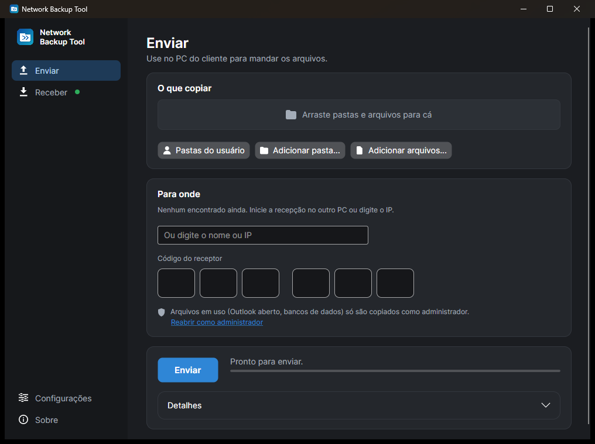
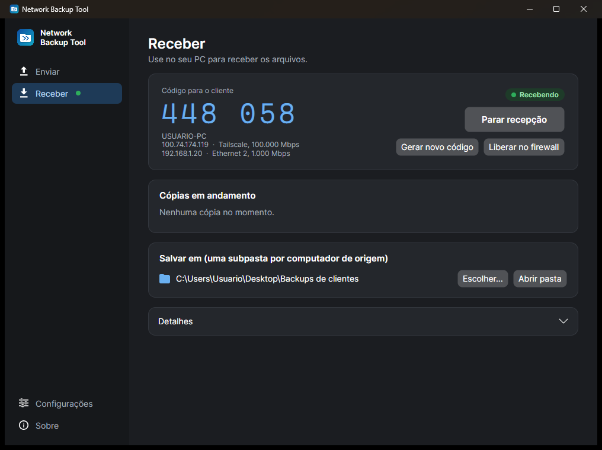

<p align="center"></p>

# Network Backup Tool

[](https://github.com/leddzeppellin/network-backup-tool/actions/workflows/build.yml)

Copia arquivos de um computador para outro da rede local **sem compartilhamento do sistema**
(sem SMB, sem pasta compartilhada, sem usuário/senha, sem grupo de trabalho). Um único executável,
sem instalar nada — dá para levar no pendrive. Funciona entre Windows, Linux e macOS, em qualquer
combinação.

| Sistema | Download |
|---|---|
| Windows 10/11 (64 bits) | [NetBackupTool.exe](https://github.com/leddzeppellin/network-backup-tool/releases/latest/download/NetBackupTool.exe) |
| Linux (x64) | [NetBackupTool-linux-x64](https://github.com/leddzeppellin/network-backup-tool/releases/latest/download/NetBackupTool-linux-x64) |
| Linux (ARM64) | [NetBackupTool-linux-arm64](https://github.com/leddzeppellin/network-backup-tool/releases/latest/download/NetBackupTool-linux-arm64) |
| macOS (Apple Silicon) | [NetBackupTool-macos-arm64.zip](https://github.com/leddzeppellin/network-backup-tool/releases/latest/download/NetBackupTool-macos-arm64.zip) |
| macOS (Intel) | [NetBackupTool-macos-x64.zip](https://github.com/leddzeppellin/network-backup-tool/releases/latest/download/NetBackupTool-macos-x64.zip) |

<p align="center">
  
  
</p>

## Como usar

**No seu PC (quem recebe)**
1. Abra o programa → **Receber** → **Iniciar recepção**.
2. Na primeira vez o sistema pode perguntar sobre o firewall: permita. No Windows, se a rede
   estiver como "Pública" e nada conectar, clique em **Liberar no firewall** (pede admin uma vez).
3. Anote o **código de 6 dígitos**.

**No PC do cliente (quem envia)**
1. Abra o mesmo programa → **Enviar**.
2. Adicione o que copiar: **Pastas do usuário** (Área de Trabalho, Documentos, Imagens, Músicas,
   Vídeos, Downloads), **Adicionar pasta**, ou arraste pastas para a janela.
3. Clique no seu computador, que aparece sozinho em "Encontrados na rede" (ou digite o IP),
   digite o código e clique em **Enviar**.

Os arquivos chegam em `<pasta de destino>/<nome do PC do cliente>/C/Users/...`, espelhando o
caminho original. Ao fim, um `_NBT_relatorio_<data>.txt` fica junto, com o que foi copiado e o que falhou.

### Primeira abertura em cada sistema

- **Windows**: se aparecer o aviso azul do SmartScreen, clique em **Mais informações → Executar
  assim mesmo** (até a assinatura digital ser aprovada).
- **Linux**: dê permissão de execução (`chmod +x NetBackupTool-linux-x64`) e abra. Precisa de um
  ambiente gráfico (qualquer distribuição com área de trabalho já tem o necessário).
- **macOS**: descompacte e mova o app para Aplicativos. Como ainda não é assinado pela Apple, na
  primeira vez o macOS bloqueia: abra **Ajustes do Sistema → Privacidade e Segurança** e clique em
  **Abrir Mesmo Assim**. Permita também o acesso à **rede local** quando o macOS perguntar.

## Configurações e modo persistente

Em **Configurações**:

- **Idioma**: português, inglês e espanhol (automático segue o sistema). **Tema**: claro, escuro
  ou seguir o sistema.
- **Modo persistente**, para deixar o seu PC sempre pronto:
  - *Ao fechar a janela, continuar recebendo*: o X esconde a janela e o programa fica com um ícone
    perto do relógio, avisando quando uma cópia começa e termina.
  - *Iniciar com o sistema, já recebendo*: entra escondido ao ligar o computador (só para o seu
    usuário, sem admin). Se mover o programa de pasta, desligue e ligue de novo.
  - *Código fixo*: o código não muda entre usos. Com ele, 5 tentativas erradas bloqueiam novas
    conexões por 5 minutos.
- **Conexões paralelas** e **arquivos ignorados** do envio.

Em **Sobre**: versão, **Verificar atualizações** (no Windows e no Linux baixa, confere o SHA-256
publicado, troca o executável e reabre; no macOS abre a página de download) e o passo a passo.

Abrir o programa de novo só traz para a frente a janela que já está rodando.
Atalho: `NetBackupTool receber` abre já recebendo.

## Por que é rápido

- **Várias conexões TCP em paralelo** (padrão 4, até 16): arquivos grandes são fatiados em
  blocos de 8 MB distribuídos entre as conexões; arquivos pequenos são processados em paralelo,
  o que esconde a latência de abrir/criar cada arquivo.
- Protocolo enxuto, sem confirmação por arquivo: os dados fluem direto, com buffers grandes.
- Medido: ~850 MB/s (≈7 Gbps) entre duas instâncias no mesmo PC e ~510 MB/s do Windows para o
  Linux (WSL). Em rede de 1 Gbps o limite passa a ser o cabo (~110 MB/s) ou o disco do cliente.

## Segurança e confiabilidade

- Só conecta quem sabe o código (HMAC-SHA256 com desafio aleatório; o código não trafega).
  Após 5 códigos errados, o código é trocado automaticamente.
- Cada bloco é conferido com xxHash3; arquivo com bloco corrompido é descartado e listado como falha.
- O receptor nunca grava fora da pasta de destino (caminhos com `..` ou absolutos são recusados).
- Verifica espaço livre antes de começar.
- **Retomada**: enviar de novo pula o que já chegou igual (mesmo tamanho e data).
- **Windows — arquivos em uso** (`.pst` com Outlook aberto, bancos de dados): rodando como
  administrador, o programa cria uma **Shadow Copy (VSS)** só quando encontra o primeiro arquivo
  assim, lê esses arquivos dela e apaga a Shadow Copy ao terminar. Sem admin, aparecem como falha
  com a dica, e a tela Enviar oferece **Reabrir como administrador** mantendo a lista de pastas.
- Pula junções do sistema e arquivos do OneDrive que só existem na nuvem (avisa a quantidade).
- O tráfego **não é criptografado** (pensado para rede local de confiança).

Portas: TCP 50505 (dados) e UDP 50506 (descoberta), só no PC que recebe.

## Compilar

Requer .NET SDK 10.

```bash
dotnet publish src/NetBackupTool.App -c Release -r win-x64 -o publish
```

Troque `win-x64` por `linux-x64`, `linux-arm64`, `osx-arm64` ou `osx-x64`. O pacote `.app` do
macOS é montado por `tools/make-macos-app.sh` (precisa de um Mac; o GitHub Actions faz isso).

Teste de ponta a ponta (gera dados temporários, envia por loopback, confere hash e data, testa
código errado, código fixo, arquivo bloqueado, exclusões, retomada, caminhos maliciosos e as
traduções); roda no Windows e no Linux:

```bash
dotnet run -c Release --project tests/Nbt.Smoke
```

No Windows, rodado num terminal **como administrador**, o mesmo teste confere que o arquivo
bloqueado chega íntegro via Shadow Copy e que a Shadow Copy é apagada no fim.

## Estrutura

- `src/Nbt.Core` — protocolo, varredura (`Manifest`), `Sender`, `Receiver`, `Discovery`,
  `ShadowCopies` (VSS) e traduções (`L`).
- `src/NetBackupTool.App` — interface (Avalonia) para Windows, Linux e macOS.
- `tests/Nbt.Smoke` — teste de ponta a ponta.
- `tools/` — geração do ícone e do pacote do macOS.

## Política de assinatura de código

As versões publicadas em [Releases](https://github.com/leddzeppellin/network-backup-tool/releases)
são compiladas pelo GitHub Actions a partir deste repositório. Assim que aprovado, o executável
de Windows passa a ser assinado gratuitamente pela [SignPath Foundation](https://signpath.org),
com certificado fornecido pela [SignPath.io](https://about.signpath.io).

- Autor, revisor e aprovador das versões: [Ricardo Valério da Silva](https://github.com/leddzeppellin)
- Privacidade: o programa não envia dados a nenhum serviço externo; só conversa com o outro
  computador da rede local que você indicar e, quando você clica em "Verificar atualizações",
  consulta as releases deste repositório no GitHub.

## Licença

[MIT](LICENSE)
